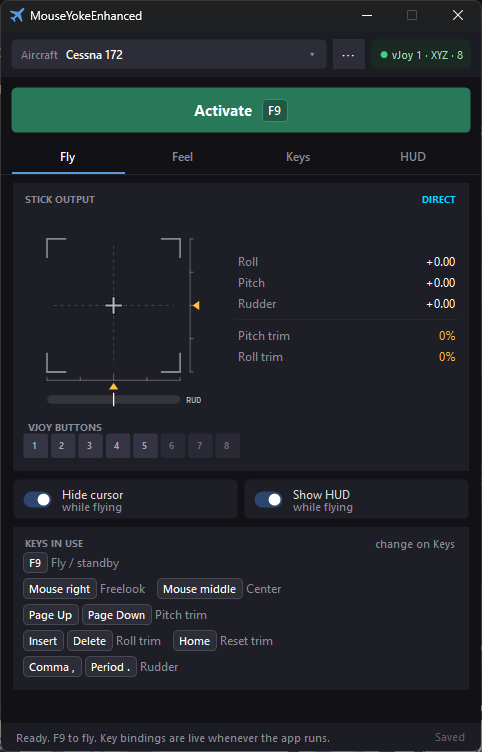
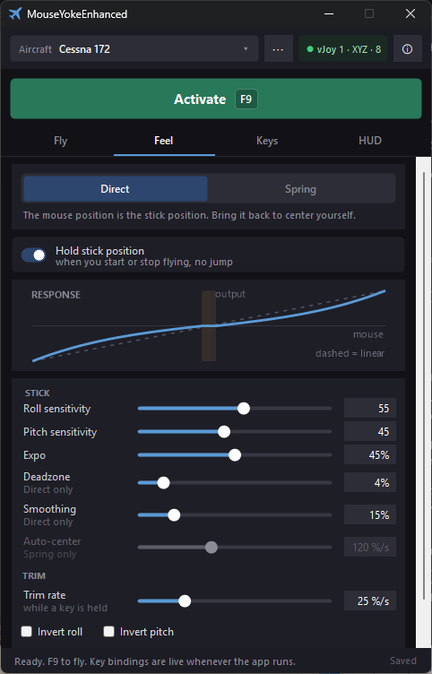
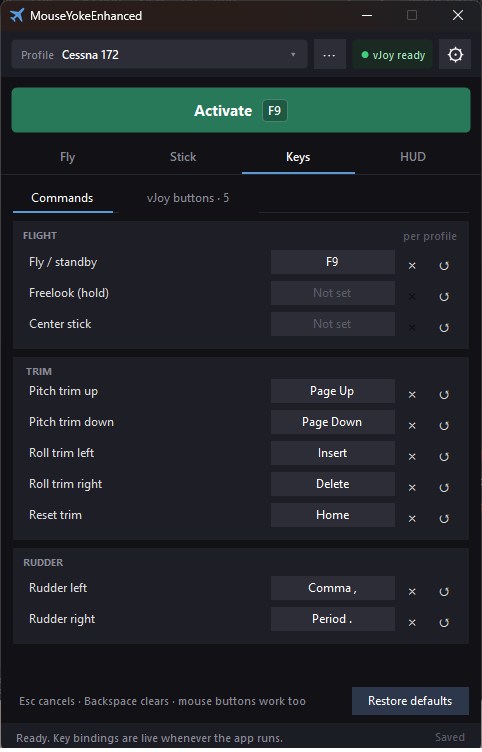
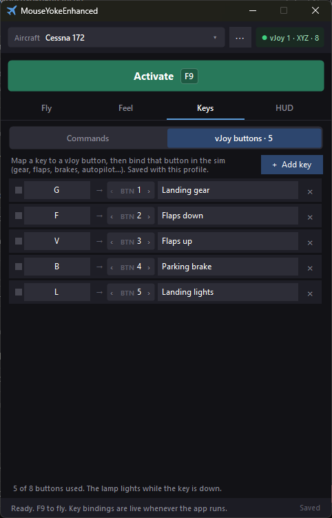
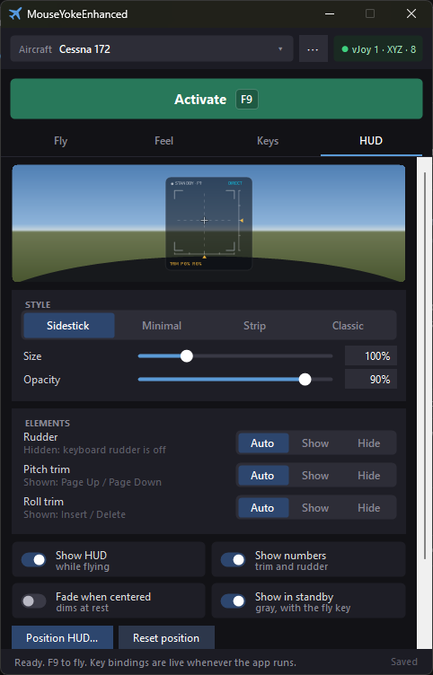
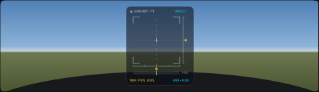
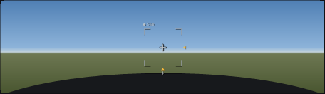
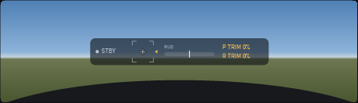
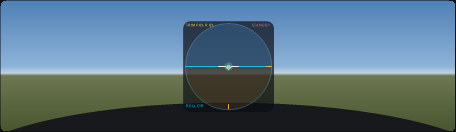
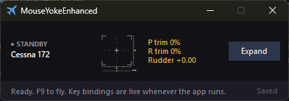

<p align="center">
  
</p>

<h3 align="center">Fly Microsoft Flight Simulator with your mouse — no joystick needed.</h3>

<p align="center">
  
  
  
</p>

<p align="center">
  
</p>

MouseYoke Enhanced turns your mouse into the aircraft's control stick. Move the mouse and the
plane rolls and pitches; hold a key to trim or work the rudder. It talks to the sim through
**vJoy**, a free virtual joystick, so Flight Simulator sees it as an ordinary controller.

It's made for people without a joystick or yoke who still want smooth, precise control,
especially on takeoff and landing.

---

## Highlights

- **Two stick modes.** *Direct* maps the mouse position to the stick. *Spring* behaves like a
  spring-loaded sidestick: nudge it and it re-centers on its own.
- **Tune the feel.** Sensitivity per axis, expo, deadzone, smoothing and auto-center, with a live
  response curve that shows what each slider does.
- **Trim that holds.** Pitch and roll trim on hold-to-move keys, plus a one-key reset.
- **Keyboard rudder.** Smooth rudder on the vJoy Z axis from two keys.
- **Extra buttons.** Map any key to a vJoy button (gear, flaps, brakes, lights…) and give it a
  name. You get as many as vJoy is set up for; 16 is recommended.
- **Every key is yours.** Rebind or clear any command. Conflicts are caught, with a one-click swap.
- **On-screen HUD.** Four styles drawn over the sim, click-through, with size, opacity and position.
- **Profiles per aircraft.** Each keeps its own feel, keys and buttons. Import and export them to
  share.
- **Stays out of the way.** Compact window, close to tray, and the icon shows a red dot while
  you're flying.
- **Safe by design.** While flying, the pointer is held on the main screen so it can't slip onto
  another monitor, and keys whose release Windows lost (after Win+L or a UAC prompt) are let go
  automatically.

---

## A quick tour

### Fly — what the sim is receiving

The Fly tab, shown at the top of this page, is the live view. The stick picture shows the output live: the green cross is the stick, the amber arrows are pitch
trim (right) and roll trim (bottom), and the bar underneath is the rudder. The vJoy button lamps
light up while their keys are down, and **Keys in use** lists your current bindings.

Press **F9** or click **Activate** to start flying with the mouse. Press **F9** again to get the
pointer back for the cockpit.

The chip at the top right checks vJoy for you (**vJoy 1 · XYZ · 16**). Green means ready; click it
when it's amber or red to see what's missing.

### Feel — make it respond your way



Pick **Direct** or **Spring** at the top, then adjust the sliders. The **Response** graph draws
the curve against a dashed linear line, and while you fly a green dot shows where the mouse sits on
it.

Sliders that don't apply to the chosen mode are grayed out. Double-click any slider to put it
back to its starting value.

<br clear="right">

### Keys — commands and vJoy buttons

<p>
  
  
</p>

**Commands** holds every keyboard command: fly/standby, trim, trim reset and rudder. Click a key
and press the new one. **Esc** cancels, **Backspace** clears, **↺** restores the default.

**vJoy buttons** maps keys to joystick buttons. Click **+ Add key**, press the key, choose the
button number and name it. Then bind that button in the sim's controls.

### HUD — your stick, over the sim



A small click-through display drawn over Flight Simulator: stick position, trim, rudder and
whether you're **ACTIVE** or in **STANDBY**. Choose the style, size and opacity, then drag it
wherever you like with **Position HUD…**. Rudder and trim indicators only appear when the
aircraft uses them, or you can show or hide each one yourself.

It also flashes **ACTIVE**, **STANDBY** or **TRIM RESET** when you press the keys, so you know
it worked even with the window hidden behind the sim.

<br clear="right">

| Sidestick | Minimal |
|:---:|:---:|
|  |  |
| **Strip** | **Classic** |
|  |  |

### Compact window and tray



Shrink MouseYoke to a strip with just the essentials, for a second screen. With **Close to tray**,
closing the window keeps it running with your keys working. Right-click the tray icon to show
the window, start or stop flying, or exit. A red dot on the icon, in the tray and on the taskbar,
means you're flying.

---

## Default keys

| Key | Action |
|---|---|
| **F9** | Start / stop mouse flying |
| **Page Up / Page Down** | Pitch trim (hold) |
| **Insert / Delete** | Roll trim (hold) |
| **Home** | Reset trim |
| **Comma , / Period .** | Rudder left / right (hold, with keyboard rudder on) |

All of them can be changed on the **Keys** tab, per aircraft profile.

---

## Getting started

1. **Install vJoy** from [github.com/jshafer817/vJoy/releases](https://github.com/jshafer817/vJoy/releases)
   and restart if asked.
2. **Configure vJoy** (once): open *Configure vJoy*, select **Device 1**, tick **X**, **Y** and
   **Z**, set **16** buttons, and apply.
3. **Start MouseYoke** (`MouseYokeVJoy.exe`). The status bar should say **Ready. F9 to fly.**
4. **Bind the axes in the sim** (once): *Options → Controls & Sensitivity*, pick **vJoy Device**,
   and assign **Ailerons** (mouse left/right), **Elevator** (mouse up/down) and, if you use keyboard
   rudder, **Rudder** (hold a rudder key).

Run the sim in **windowed** or **borderless** mode, and don't run it as Administrator, or
MouseYoke can't see your keys.

📖 The full **[user manual](MouseYokeEnhanced/MouseYoke_Manual.md)** covers every option and has a
*Quick fixes* section.

---

## Requirements

- Windows 10 or 11, 64-bit
- [.NET 8 Desktop Runtime](https://dotnet.microsoft.com/download/dotnet/8.0) (x64)
- [vJoy](https://github.com/jshafer817/vJoy/releases), device 1 with X, Y, Z and 16 buttons
- Microsoft Flight Simulator (or another sim that reads a joystick)

## Download

Get a build from the [Releases](https://github.com/rangelsantos/MouseYokeEnhanced/releases) page
when one is published, or build it yourself:

```powershell
dotnet build MouseYokeEnhanced\MouseYokeVJoy.csproj -c Release
```

Building needs the .NET 10 SDK (the app still targets .NET 8). The output is in
`MouseYokeEnhanced\bin\Release\net8.0-windows7.0\`. Profiles and settings are saved next to the
exe, so keep the folder somewhere you can write to (not Program Files).

---

## Credits

MouseYoke Enhanced builds on the original **MouseYoke** (MouseYokeVJoy 1.0.0), with a new
interface and new features. Joystick output goes through
[vJoy](https://github.com/jshafer817/vJoy).

<p align="center">Enjoy the skies! ✈️</p>
